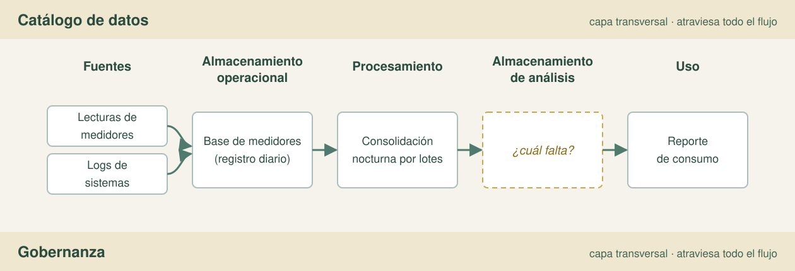

# Handout del equipo — Taller Sesión 5: diseñar la arquitectura de un caso

**Módulo:** Ingeniería de Datos (IDT 601) · Bloque 3 — Arquitectura de Datos
**Para:** equipos de 4 personas · **Tiempo de trabajo:** 50–60 min · **Entrega:** diagrama + plantilla + justificación

Este handout es tu **andamiaje**: no trae la solución hecha, trae los criterios y la plantilla para que la
construyan ustedes. Los espacios en blanco son para completar a mano.

---

## El caso

> Una gobernación quiere mejorar la atención al ciudadano. Hoy los reclamos se registran en tres sistemas
> (ventanilla, teléfono y formulario web), las inspecciones se anotan en papel y los indicadores se arman a mano
> en Excel. Se necesita un **reporte mensual confiable** de reclamos atendidos y una **alerta inmediata** cuando
> un reclamo crítico se repite en la misma zona.

**Tu énfasis (lo asigna el docente):**
- **A — reportes mensuales:** prioriza datos limpios y confiables.
- **B — alerta inmediata:** prioriza frescura de los datos.
- **C — análisis histórico:** prioriza guardar todo para explorar después.

---

## Los cuatro criterios para elegir el patrón

No hay un patrón mejor: hay uno **adecuado**. Justifica siempre con estos cuatro:

1. **Uso / caso** — ¿para qué se usan los datos? (reporte, alerta, exploración)
2. **Volumen** — ¿cuánto dato y a qué velocidad crece?
3. **Estructura del dato** — ¿estructurado, semiestructurado o no estructurado?
4. **Necesidad de tiempo real** — ¿la decisión cambia si el dato llega un minuto antes? ¿o basta con horas?

> **Pista:** "en tiempo real" es la excepción, no lo normal. Pregunten **cuánta latencia tolera** la decisión
> antes de elegir streaming o lambda.

---

## Los cuatro patrones, de un vistazo

| Patrón | Qué guarda | Foco | Tiempo real | Riesgo o costo |
|---|---|---|---|---|
| **Data warehouse** | Datos procesados y limpios | Reportes confiables | No | Poco flexible ante datos nuevos. |
| **Data lake** | Datos crudos y diversos | Guardar todo | No | Sin gobierno se vuelve "pantano de datos". |
| **Data lakehouse** | Crudo **+** esquema y gobierno | Analizar ambos mundos | Parcial | Exige más herramientas y madurez. |
| **Lambda** | Lote **+** velocidad (dos caminos) | Reportes **y** alertas | Sí | Dos lógicas que mantener; mayor complejidad. |

---

## Las fuentes del caso y su tipo

| Fuente | Qué registra | Tipo de dato | Formato |
|---|---|---|---|
| Sistema de ventanilla | Reclamos presenciales, con n.º de expediente | Estructurado | Tablas de BBDD |
| Sistema telefónico | Reclamos y consultas por llamada | Estructurado | Tablas de BBDD |
| Formulario web | Reclamos con texto libre | Semiestructurado | JSON |
| Inspecciones en papel | Actas con observaciones manuscritas | No estructurado | Documentos escaneados |
| Planilla de indicadores | Indicadores armados a mano | Estructurado | Excel |

> **No trates igual el JSON y el papel.** El formulario web es un dato con estructura flexible; un acta escaneada
> es una imagen que hay que **extraer** (y que puede necesitar revisión humana). Esa diferencia es una decisión
> de diseño.

---

## Cómo se ve un buen diagrama (ejemplo resuelto parcial, de otro caso)

Este es un ejemplo **de otro dominio** (medidores de agua), y está **a propósito incompleto**. Complétalo
mentalmente y fíjate en la forma, no lo copies.

**Qué mirar:** (1) las fuentes nacen a la izquierda y el uso vive a la derecha; (2) **almacenar no es transformar**
—son dos cajas distintas—; (3) hay **dos** almacenamientos: el del día a día y el de análisis; (4) catálogo y
gobernanza son **bandas que atraviesan todo**, no una caja más de la fila.

**Tu diagrama debe**: partir de las fuentes del caso, mostrar el procesamiento por separado, llegar al uso, e
incluir catálogo y gobernanza como capas transversales. Que lo entienda alguien que no es de tu equipo.

---

## Plantilla de diseño (complétenla)

### 1. Caso y objetivo
- Qué necesita la institución: ______________________________________________
- Qué pregunta(s) debe responder la arquitectura: ___________________________

### 2. Fuentes de datos
| Fuente | Tipo (estructurado / semiestructurado / no estructurado) |
|---|---|
| | |
| | |
| | |

### 3. Componentes
| Componente | Cómo aparece en nuestro diseño |
|---|---|
| Almacenamiento (¿dónde se guarda?) | |
| Procesamiento (¿qué transforma?) | |
| Catálogo (¿qué es y de dónde viene cada dato?) | |
| Gobernanza (¿quién accede y con qué reglas?) | |

### 4. Patrón elegido
- Patrón: ______________________
- Justificación (los cuatro criterios): ____________________________________
- **Alternativa descartada y por qué:** ___________________________________

### 5. Diagrama de flujo
*(Dibújenlo aparte; péguenlo aquí o refiéranlo.)*

### 6. Reglas de gobernanza
- Quién accede: __________________________________________________________
- Calidad (¿qué dimensiones y en qué campo?): _____________________________
- Seguridad y retención: __________________________________________________

---

## Errores frecuentes (y cómo evitarlos)

Léelos y contrasta con tu diseño. **Nombrar el error es el primer paso para no cometerlo.**

| Si pensaste… | En realidad… |
|---|---|
| "Guardamos y limpiamos en la misma caja." | Guardar responde **dónde**; transformar responde **cómo**. Sepáralos. |
| "El catálogo es una etapa del flujo." | No está *entre* dos etapas: **atraviesa** todas. Igual la gobernanza. |
| "El lakehouse/lambda es mejor porque es más nuevo." | Se elige por **caso, volumen, estructura y tiempo real**, no por prestigio. |
| "Lambda es la forma de tener tiempo real." | Es *una* forma, y la más cara. Si toleras minutos, micro-lote basta. |
| "El formulario web y el papel se tratan igual." | El JSON tiene estructura flexible; el papel hay que **extraerlo** (OCR), tal vez con revisión humana. |
| "Los tres sistemas son la misma fuente." | Son tres registros del **mismo hecho**: sin un identificador común aparecen **duplicados**. |
| "La gobernanza es un comité que se reúne." | Son **responsables con reglas escritas**: quién es dueño, quién accede, quién responde por la calidad. |
| "La alerta no necesita reglas." | Toda alerta necesita dueño, umbral, ventana y destinatario. |

---

## Glosario mínimo

- **Esquema fijo / esquema al leer:** se define al guardar / se aplica al consultar.
- **Streaming / micro-lote / lote:** dato al instante / cada segundos o minutos / cada cierto tiempo.
- **Data swamp (pantano de datos):** lake sin catálogo ni gobierno: se acumula todo y no se encuentra nada.
- **Deduplicación:** eliminar registros repetidos del mismo hecho (aquí, entre los tres canales).
- **Metadato:** dato sobre el dato (definición, origen, dueño); vive en el catálogo.
- **Capas bronce / plata / oro:** crudo → validado → enriquecido, listo para reportar.
- **Gobernanza:** quién puede usar el dato, con qué reglas de calidad, seguridad y retención.

---

## Checklist antes de entregar

- [ ] El objetivo responde a una pregunta concreta.
- [ ] Cada fuente está listada **con su tipo**.
- [ ] Aparecen los **cuatro** componentes.
- [ ] El patrón está **justificado con los cuatro criterios**.
- [ ] Incluye **una alternativa descartada con motivo**.
- [ ] El diagrama va de la fuente al uso y se entiende solo.
- [ ] **Catálogo y gobernanza** aparecen como capas transversales.
- [ ] Las reglas de gobernanza dicen **quién accede** y **cómo se controla la calidad**.

---

## Para profundizar (casos reales de gobierno)

- **Montevideo — Sistema Único de Reclamos (SUR):** cinco canales unificados, estados y taxonomía
  tipo→grupo→área, reclamos georreferenciados. Datos abiertos de la Intendencia de Montevideo.
- **Open311 (GeoReport v2):** el estándar abierto para unificar reclamos entre canales y sistemas.
- **Colombia — MinTIC, Resolución 2893/2020:** arquitectura de referencia "por zonas" para ventanillas únicas,
  con registro consecutivo y "fuentes únicas" para evitar duplicados.
- **Puyango (Ecuador) — "Cómo va mi barrio" (PNUD, 2024):** flujo reporte → gestión → seguimiento con foto como
  evidencia.
- **Córdoba (Argentina) — SIRAD:** gestión documental con módulo de reclamos geolocalizado y reportes de gestión.
- **Gobernanza y calidad:** CEPAL (2023), gobernanza de datos en el sector público; ISO/IEC 25012 (calidad de
  datos); en Bolivia, Ley 1080 y el Manual de Protección de Datos de AGETIC.

Referencias completas y su respaldo: `.research/taller-sesion5-materiales/REPORT.md`.
