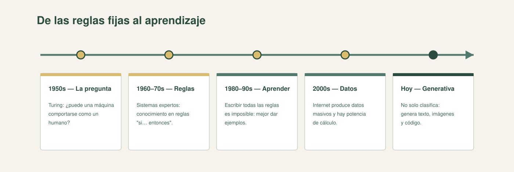
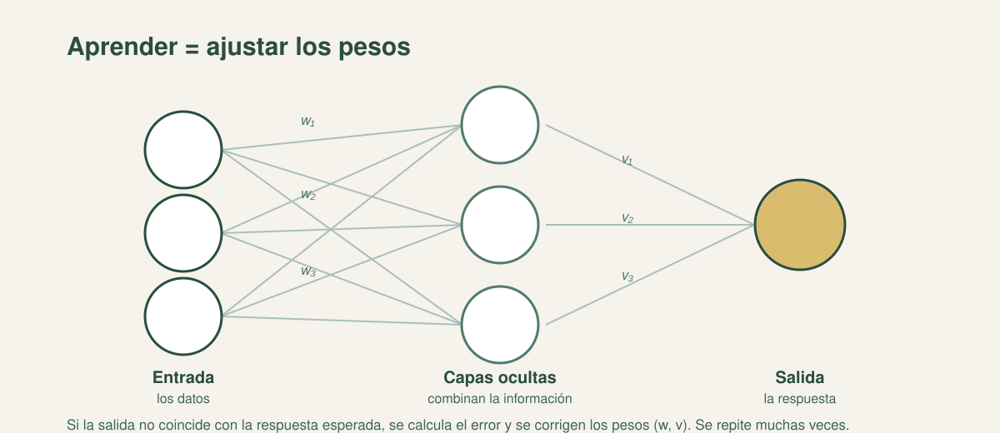

<!-- .slide: class="cover" -->

Ingeniería de Datos · IDT 601

<h1>Inteligencia artificial: historia, redes neuronales y aprendizaje</h1>

De las reglas fijas al aprendizaje con datos.

Bloque 6 · Sesión 8 · EGPP

IA =reglas + datos+ aprendizaje

Note:
- Dar la bienvenida y ubicar el **Bloque 6 — Historia y Desarrollo de la Inteligencia Artificial**.
- Encuadrar la sesión como un recorrido: **de las reglas fijas al aprendizaje con datos**.
- Aclarar que el público no es especialista: "no hace falta programar; vamos a entender las ideas".
- Anunciar las palabras clave del día: **regla, dato, modelo, predicción, neurona, peso, entrenamiento, etiqueta, sobreajuste, métrica**.
- **No olvidar:** avisar que hay una **pausa de 10 minutos** y que el cierre incluye una dinámica en equipos.

---

01 / Hoja de ruta180 minutos

<h2 class="slide-title">Una sola sesión, nueve tramos</h2>
  <table class="type-table">
    <thead><tr><th>Bloque</th><th>Tiempo</th><th>Qué haremos</th></tr></thead>
    <tbody>
      <tr><td>Apertura y encuadre</td><td>10 min</td><td>Bienvenida, Bloque 6 y las tres preguntas.</td></tr>
      <tr><td>Historia de la IA</td><td>20 min</td><td>Cinco momentos, sin tecnicismos.</td></tr>
      <tr><td>Dos perspectivas</td><td>25 min</td><td>Determinista vs. indeterminista y cuándo conviene cada una.</td></tr>
      <tr><td>Pausa</td><td>10 min</td><td>Receso.</td></tr>
      <tr><td>Qué es una red neuronal</td><td>35 min</td><td>Neurona, capas, pesos, entrenamiento, sobreajuste y métricas.</td></tr>
      <tr><td>Tipos de aprendizaje</td><td>25 min</td><td>Supervisado, no supervisado y por refuerzo.</td></tr>
      <tr><td>Ejemplos en la gestión pública</td><td>10 min</td><td>Casos aplicados a datos del Estado.</td></tr>
      <tr><td>Dinámica: ¿regla, dato o aprendizaje?</td><td>30 min</td><td>Dos rondas de 4 casos y puesta en común (3 equipos).</td></tr>
      <tr><td>Cierre y preguntas</td><td>15 min</td><td>Síntesis y puente a los LLM.</td></tr>
    </tbody>
  </table>

Hoja de ruta02

Note:
- Presentar los **nueve tramos** contando esta apertura: historia, dos perspectivas, pausa, redes neuronales, tipos de aprendizaje, ejemplos, dinámica y cierre.
- Marcar los tiempos: 20 min de historia, 25 de perspectivas, 35 de redes, 25 de tipos, 10 de ejemplos, 30 de dinámica y 15 de cierre.
- Explicar que la teoría y la práctica se alternan para que nadie se canse de escuchar.
- **No olvidar:** remarcar la **pausa de 10 min** y el bloque de la dinámica, los dos respiros de las tres horas.

---

02 / EncuadreTres preguntas

  
<h2 class="slide-title">Las preguntas de la sesión</h2>
Saber responderlas es entender cómo <strong>piensa</strong> —y cómo <strong>falla</strong>— la IA de hoy.

  

1. ¿<strong>Qué es</strong> la IA y de dónde viene? 2. ¿Sigue <strong>reglas</strong> o <strong>aprende</strong> de los datos? 3. ¿<strong>Cómo aprende</strong> una red neuronal?

Encuadre03

Note:
- Plantear las tres preguntas: **¿qué es la IA y de dónde viene?**, **¿sigue reglas o aprende de los datos?**, **¿cómo aprende una red neuronal?**.
- Enganchar: "¿cómo aprendiste a distinguir un trámite **urgente** de uno normal? ¿con ejemplos etiquetados, agrupando o a los golpes?".
- Señalar que cada respuesta anticipa uno de los **tres tipos de aprendizaje** que veremos más adelante.
- **No olvidar:** decir que quien responda estas tres preguntas entiende cómo piensa y cómo falla la IA actual.

---

03 / Qué es la IADos caminos

  
<h2 class="slide-title">Dos caminos para la misma tarea</h2>
La IA busca que las máquinas hagan tareas que requieren inteligencia humana. Hay dos maneras de lograrlo, y casi siempre se <strong>mezclan</strong>.

  

<h3>Decirle qué hacer</h3>
Reglas fijas escritas por un humano. El sistema las cumple paso a paso.

Qué es la IA04

Note:
- Presentar los dos caminos como el hilo de toda la sesión: **determinista e indeterminista**.
- Explicar "decirle qué hacer": reglas fijas escritas por un humano, cumplidas paso a paso.
- Explicar "dejar que descubra": el sistema aprende **patrones de los datos** y no le escribimos las reglas.
- Preguntar al grupo en qué camino ubicarían el trabajo de su institución.
- **No olvidar:** advertir que la IA real casi siempre **mezcla** los dos caminos y no hay uno mejor que el otro.

---

04 / HistoriaCinco momentos

<h2 class="slide-title">Historia de la IA en cinco momentos</h2>
  <table class="type-table">
    <thead><tr><th>Momento</th><th>Aportación</th></tr></thead>
    <tbody>
      <tr><td>1950s — La pregunta</td><td>Turing: ¿puede una máquina comportarse como un humano?</td></tr>
      <tr><td>1960–70s — Las reglas</td><td>Sistemas expertos: el conocimiento codificado en reglas "si… entonces".</td></tr>
      <tr><td>1980–90s — El aprendizaje</td><td>Imposible escribir todas las reglas → dar ejemplos.</td></tr>
      <tr><td>2000s — Datos y cómputo</td><td>Internet produce datos masivos y hay potencia de cálculo.</td></tr>
      <tr><td>Hoy — IA generativa</td><td>No solo clasifica: genera texto, imágenes y código.</td></tr>
    </tbody>
  </table>
  

Historia de la IA05

Note:
- Recorrer los cinco momentos como un relato, sin tecnicismos: **1950s la pregunta**, **1960–70s las reglas**, **1980–90s el aprendizaje**, **2000s datos y cómputo**, **hoy IA generativa**.
- Contar el punto de partida: **Turing** y su pregunta por una máquina que se comporte como humano.
- Explicar el giro de los 80–90: codificar todas las reglas del mundo es imposible, mejor dar **ejemplos**.
- **Esquema en pantalla (línea de tiempo):** cinco hitos sobre la línea; conectar el presente con la vida cotidiana (traducción, asistentes de chat, reconocimiento de imágenes).
- **No olvidar:** cerrar con el mensaje puente: en toda esta historia conviven las **dos filosofías** (decirle qué hacer o dejar que descubra).

---

05 / PerspectivasComparación

<h2 class="slide-title">Dos perspectivas</h2>
  <table class="type-table">
    <thead><tr><th>Aspecto</th><th>Determinista</th><th>Indeterminista</th></tr></thead>
    <tbody>
      <tr><td>Reglas</td><td>Escritas a mano.</td><td>Aprendidas de los datos.</td></tr>
      <tr><td>Comportamiento</td><td>Predecible.</td><td>Probabilístico.</td></tr>
      <tr><td>Explicabilidad</td><td>Alta.</td><td>Puede ser baja.</td></tr>
      <tr><td>Datos necesarios</td><td>Pocos.</td><td>Muchos.</td></tr>
      <tr><td>Ideal para</td><td>Reglas claras y estables.</td><td>Patrones complejos y cambiantes.</td></tr>
      <tr><td>Ejemplos</td><td>Verificación de documentos, semáforo.</td><td>Recomendación, predicción.</td></tr>
    </tbody>
  </table>

Dos perspectivas06

Note:
- Leer la tabla con el grupo, fila por fila, deteniéndose en **explicabilidad** y **cantidad de datos**.
- Aclarar que el determinista es **predecible y auditable**; el indeterminista es **probabilístico** y a veces "caja negra".
- Reforzar: **no es cuál es mejor, sino cuál se ajusta al problema**.
- Preguntar: "¿qué trámites de su institución son 100% verificables y cuáles requieren criterio?".
- **No olvidar:** remarcar que un sistema indeterminista **puede equivocarse** y a veces no sabemos por qué, por eso exige control humano.

---

05 / PerspectivasDeterminista

  
<h2 class="slide-title">Perspectiva determinista</h2>
Funciona con <strong>reglas fijas</strong> escritas por un humano. Misma entrada → <strong>siempre</strong> la misma salida, y se puede seguir el razonamiento paso a paso.

  

<h3>Ejemplo</h3>
Un sistema que aprueba un trámite solo si están todos los documentos obligatorios. O un <strong>semáforo programado</strong>: no "piensa", cumple un plan.

Dos perspectivas07

Note:
- Explicar la regla `si (condición) entonces (acción)`: misma entrada, **siempre** la misma salida.
- Destacar las ventajas: **predecible, auditable y fácil de explicar**.
- Usar los ejemplos: verificación de documentos de un trámite y un **semáforo programado** que cumple un plan.
- Señalar el límite: ante un caso **no previsto**, el sistema no sabe qué hacer.
- **No olvidar:** insistir en que su fuerza y su debilidad son la misma: solo hace lo que **alguien escribió** antes.

---

05 / PerspectivasIndeterminista

  
<h2 class="slide-title">Perspectiva indeterminista</h2>
El sistema <strong>aprende patrones de ejemplos</strong>. No hay reglas escritas: se construyen de los datos. La salida es <strong>probabilística</strong> y a veces poco explicable.

  

<h3>Ejemplo</h3>
Un sistema que clasifica <strong>reclamos por tema</strong>: no le dijimos la regla; aprendió de miles de reclamos ya derivados.

Dos perspectivas08

Note:
- Explicar que el sistema **aprende patrones de ejemplos** y que las reglas se construyen de los datos.
- Señalar que la salida es **probabilística**: da una respuesta con un nivel de confianza, no con certeza.
- Ilustrar con el clasificador de **reclamos por tema**, que aprendió de miles de reclamos ya derivados.
- Hablar del límite: **menos explicable a veces**, la llamada "caja negra".
- **No olvidar:** aclarar que "caja negra" no significa magia, sino que nos cuesta **seguir el razonamiento** de la máquina.

---

05 / Perspectivas¿Cuál conviene?

<h2 class="slide-title">¿Cuándo conviene cada enfoque?</h2>
  

    <article class="card"><h3>Determinista</h3>
<strong>Trámite</strong> con requisitos claros y fijos → verificación de documentos.
</article>
    <article class="card"><h3>Indeterminista</h3>
<strong>Predicción de demanda</strong> según estación y clima → hay patrones, no reglas simples.
</article>
    <article class="card"><h3>Combinada</h3>
Un <strong>filtro de spam</strong> mezcla reglas del remitente con aprendizaje del contenido.
</article>
  

Dos perspectivas09

Note:
- Recorrer las tres tarjetas: determinista con **requisitos claros**, indeterminista cuando **hay patrones**, combinada con **reglas + datos**.
- Aterrizar con ejemplos: un trámite municipal con requisitos fijos y la **predicción de demanda** de un servicio.
- Explicar la combinada con el **filtro de spam**: reglas del remitente más aprendizaje del contenido.
- Dar la regla práctica: "¿puedo escribir la regla en una frase? → determinista; ¿necesito ver muchos ejemplos? → indeterminista".
- **No olvidar:** hacer la transición: "cuando el sistema realmente aprende de los datos, aparece su herramienta estrella, la **red neuronal**".

---

06 / Redes neuronalesLa neurona

  
<h2 class="slide-title">La neurona artificial</h2>
Inspirada en la neurona biológica: recibe <strong>entradas</strong>, las <strong>pondera</strong> (da más importancia a unas que a otras) y produce una <strong>salida</strong>.

  

<h3>Analogía</h3>
Un funcionario de ventanilla: recibe varios papeles, da más peso a unos y decide una respuesta.

Redes neuronales10

Note:
- Explicar la analogía del **funcionario de ventanilla**: recibe papeles (entradas), da más peso a unos y decide una respuesta (salida).
- Definir **entradas**, **ponderación** y **salida** con palabras simples.
- Dibujar en la pizarra una neurona con varias entradas y una salida.
- Anticipar que esas "importancias" se llaman **pesos** y que serán la clave del aprendizaje.
- **No olvidar:** quedarse en la analogía cotidiana, sin fórmulas, porque el público no es especialista.

---

06 / Redes neuronalesLas capas

<h2 class="slide-title">Las capas de la red</h2>
  

    <article class="card"><h3>Entrada</h3>
Recibe los datos: las características de cada ejemplo.
</article>
    <article class="card"><h3>Capas ocultas</h3>
Procesan y combinan la información.
</article>
    <article class="card"><h3>Salida</h3>
Entrega el resultado: una etiqueta, un número, una decisión.
</article>
  

  

Redes neuronales11

Note:
- Presentar las tres capas: **entrada** (recibe los datos), **ocultas** (procesan y combinan) y **salida** (entrega el resultado).
- Usar la analogía de la **cadena de decisiones**: cada oficina recibe lo que resolvió la anterior y lo refina.
- **Esquema en pantalla (red):** mostrar 3 entradas → capa oculta → salida, y que cada flecha tiene un peso (`w`, `v`).
- Aclarar que las capas ocultas son las que permiten combinar información compleja.
- **No olvidar:** decir que todas las conexiones entre capas tienen **pesos** que la red aprenderá a ajustar.

---

06 / Redes neuronalesEntrenamiento

  
<h2 class="slide-title">Pesos y entrenamiento</h2>
Cada conexión tiene un <strong>peso</strong>: cuánto importa esa entrada. <strong>Aprender = ajustar los pesos</strong> para reducir el error.

    <ol>
      <li>Se presentan <strong>ejemplos</strong>.</li>
      <li>La red produce una <strong>salida</strong>.</li>
      <li>Se compara con lo esperado y se calcula el <strong>error</strong> (función de pérdida).</li>
      <li>Se <strong>ajustan los pesos</strong> para reducir el error.</li>
      <li>Se repite muchas veces: cada pasada completa es una <strong>época</strong>.</li>
    </ol>
  

  

<h3>Analogía</h3>
Afinar un instrumento o tirar al aro: repetir y corregir en función del error.

Redes neuronales12

Note:
- Definir el **peso** como cuánto importa cada entrada, y sentenciar: **aprender = ajustar los pesos**.
- Recorrer el ciclo: ejemplos → salida → error → ajuste de pesos → repetir. Nombrar la **función de pérdida** como la medida del error y la **época** como una pasada completa.
- Usar la analogía de **afinar un instrumento** o **tirar al aro**: repetir y corregir según el error.
- **No olvidar:** recalcar que el **error** es el motor del aprendizaje; sin comparar con lo esperado, la red no aprende.

---

06 / Redes neuronalesDemo vs. producción

  
<h2 class="slide-title">Funciona en la demo, falla en producción</h2>
Si medimos con los <strong>mismos datos</strong> con que aprendió, siempre parece bueno. Por eso se separan los datos en tres grupos y se vigila el <strong>sobreajuste</strong>.

  

<h3>Los tres grupos</h3>
<strong>Entrenamiento:</strong> con él aprende. <strong>Validación:</strong> para ajustar durante el desarrollo. <strong>Prueba:</strong> nunca lo vio; estima los casos nuevos.

Redes neuronales13

Note:
- Explicar por qué medir con los mismos datos engaña: el modelo los **memoriza**.
- Presentar los tres grupos: **entrenamiento**, **validación** y **prueba**; la prueba es la que estima el desempeño con casos nuevos.
- Definir **sobreajuste**: acierta en lo conocido y falla en lo nuevo; es la causa típica del "en la demo andaba y en producción no".
- **No olvidar:** el conjunto de prueba **no se usa para aprender**; es el espejo de la realidad.

---

06 / Redes neuronalesMétricas

<h2 class="slide-title">Cómo medimos: exactitud y precisión</h2>
  

    
<h3>Exactitud</h3>
Proporción de aciertos sobre el <strong>total</strong> de casos evaluados.

    
<h3>Precisión</h3>
De los casos que el modelo marcó como <strong>positivos</strong>, cuántos lo eran de verdad.

  

  
No son lo mismo. Una exactitud alta con precisión baja obliga a preguntar <strong>para qué</strong> se usará el modelo: el costo del error cambia según el trámite.

Redes neuronales14

Note:
- Definir **exactitud** (aciertos sobre el total) y **precisión** (de los marcados como positivos, cuántos lo eran).
- Aclarar que **no son lo mismo** y que la métrica a mirar depende del costo del error.
- Dar un ejemplo de gestión: no es lo mismo filtrar unos pocos casos dudosos que decidir sobre un trámite.
- **No olvidar:** elegir bien la métrica es una decisión de gestión, no solo técnica.

---

07 / Tipos de aprendizajeLa tabla central

<h2 class="slide-title">Tres tipos de aprendizaje</h2>
  <table class="type-table">
    <thead><tr><th>Tipo</th><th>Datos</th><th>¿Qué aprende?</th><th>Señal</th></tr></thead>
    <tbody>
      <tr><td>Supervisado</td><td>Etiquetados</td><td>Predecir etiqueta o valor.</td><td>Respuesta correcta</td></tr>
      <tr><td>No supervisado</td><td>Sin etiquetas</td><td>Agrupar y hallar patrones.</td><td>Estructura de los datos</td></tr>
      <tr><td>Por refuerzo</td><td>Interacción</td><td>Decidir acciones.</td><td>Recompensa / penalización</td></tr>
    </tbody>
  </table>

Tipos de aprendizaje15

Note:
- Presentar la tabla: **supervisado** (datos etiquetados), **no supervisado** (sin etiquetas) y **por refuerzo** (interacción).
- Explicar la señal de cada uno: **respuesta correcta**, **estructura de los datos** y **recompensa o penalización**.
- Adelantar que esta tabla es la parte central y que se retomará en el cierre y en la dinámica.
- **No olvidar:** decir que la elección depende de **qué datos tenemos** y de **qué problema queremos resolver**; y que el preentrenamiento **corrige pesos**, no "refuerza".

---

07 / Tipos de aprendizajeDe cerca

<h2 class="slide-title">Los tres tipos, de cerca</h2>
  

    <article class="card"><h3>Supervisado</h3>
Datos <strong>etiquetados</strong>. Clasificación y regresión. Ej.: clasificar un trámite como "urgente" o "no urgente".
</article>
    <article class="card"><h3>No supervisado</h3>
Datos <strong>sin etiquetas</strong>. Agrupa y halla patrones. Ej.: segmentar ciudadanos según su uso de servicios.
</article>
    <article class="card"><h3>Por refuerzo</h3>
<strong>Ensayo, error y recompensa.</strong> Ej.: optimizar semáforos probando combinaciones.
</article>
  

Tipos de aprendizaje16

Note:
- Profundizar el **supervisado**: clasificación y regresión; ejemplo, clasificar un trámite como "urgente" o "no urgente".
- Profundizar el **no supervisado**: agrupar y hallar patrones; ejemplo, segmentar ciudadanos según su uso de servicios.
- Profundizar el **refuerzo**: ensayo, error y recompensa; ejemplo, optimizar semáforos probando combinaciones.
- Dar las tres preguntas de control: **¿hay etiquetas? ¿se busca agrupar? ¿hay una acción y una recompensa?**.
- **No olvidar:** anunciar que esas tres preguntas son exactamente las que se usarán en la **Ronda 2** de la dinámica.

---

08 / AplicaciónGestión pública

<h2 class="slide-title">Casos en la gestión pública</h2>
  

    <article class="card"><h3>Supervisado</h3>
Clasificar <strong>reclamos</strong> por tema; predecir la <strong>demanda</strong> de un servicio.
</article>
    <article class="card"><h3>No supervisado</h3>
Segmentar <strong>beneficiarios</strong> de programas sociales; detectar <strong>anomalías</strong> en gastos.
</article>
    <article class="card"><h3>Por refuerzo</h3>
Optimizar <strong>rutas</strong> de recolección de residuos; asignar recursos dinámicamente.
</article>
  

  
No siempre hay etiquetas: a veces solo queremos descubrir grupos; a veces decidir en secuencia. Por eso hay más de un tipo de aprendizaje.

Aplicación17

Note:
- Aterrizar con ejemplos **bolivianos**: municipios, alcaldías, gobernaciones y centros de salud.
- Supervisado: clasificar **reclamos** por tema y predecir la **demanda** de un servicio para planificar turnos.
- No supervisado: **segmentar beneficiarios** de programas sociales y **detectar anomalías** en gastos.
- Por refuerzo: **optimizar rutas** de recolección de residuos y asignar recursos dinámicamente.
- **No olvidar:** remarcar que estas técnicas **ya se usan en el Estado**, no son ciencia ficción.

---

09 / Dinámica30 minutos

<h2 class="slide-title">¿Regla, dato o aprendizaje?</h2>
  

    <article class="card"><h3>1. Ronda 1</h3>
En equipos de 3–4, clasifiquen <strong>4 casos</strong> como determinista, indeterminista o combinada.
</article>
    <article class="card"><h3>2. Ronda 2</h3>
Clasifiquen otros <strong>4 casos</strong> como supervisado, no supervisado o por refuerzo, e indiquen la señal.
</article>
    <article class="card"><h3>3. Puesta en común</h3>
Cada equipo comparte el caso más fácil, el más discutido y por qué (3 equipos).
</article>
  

  
Entregable: la <strong>ficha de la dinámica</strong> (plantilla-ficha-dinamica.md). Ojo: la opción <strong>"combinada"</strong> suele ser válida.

Dinámica18

Note:
- Repartir las tarjetas y conformar **3 equipos** de 3–4 personas; 30 minutos en total.
- Explicar la **Ronda 1** (¿regla o dato? determinista, indeterminista o combinada) y la **Ronda 2** (supervisado, no supervisado o refuerzo), con **4 casos por ronda**.
- Indicar la **puesta en común**: el caso más fácil, el más discutido y por qué, 2–3 min por equipo.
- Recordar que la opción **"combinada"** suele ser válida (la verificación de formularios mezcla reglas y aprendizaje).
- **No olvidar:** valorar la **justificación**, no solo la respuesta; se evalúa participación, coherencia y argumentación (ver la rúbrica, Sesión 8).

---

10 / En resumenCierre

<h2 class="slide-title">No hay un enfoque mejor: hay el que se ajusta</h2>
  

    <article class="card"><h3>Reglas o datos</h3>
Determinista si las reglas son claras; indeterminista si hay patrones que cuesta codificar.
</article>
    <article class="card"><h3>La red aprende</h3>
Ajusta <strong>pesos</strong> para reducir el <strong>error</strong>; se mide con un conjunto que nunca vio.
</article>
    <article class="card"><h3>Tres formas</h3>
Supervisado, no supervisado y por refuerzo: depende de los datos y del problema.
</article>
  

  
Próxima sesión: de la red neuronal al <em>LLM</em> — los modelos de lenguaje y el prompting.

Fin de la sesión19

Note:
- Repetir el criterio central: no se trata de cuál modelo es mejor, sino de cuál **se ajusta al problema**.
- Recordar que una red neuronal aprende **ajustando pesos** y que se evalúa con datos que **nunca vio** (prueba), vigilando el sobreajuste.
- Mencionar los usos ya presentes en la gestión pública: trámites, anomalías, segmentación y optimización de recursos.
- Anticipar la próxima sesión: del modelo biológico al **LLM**, los modelos de lenguaje y el prompting.
- **No olvidar:** dejar claro que la IA no es magia: es matemática ajustada con datos.

---

<!-- .slide: class="dark" -->

FinIngeniería de Datos · IDT 601

  <h2 class="slide-title">Gracias</h2>
  
Bloque 6 · Sesión 8 · Historia, redes y aprendizaje

  
Reglas + datos + aprendizaje.

EGPP · Escuela de Gestión Pública Plurinacional20

Note:
- Agradecer la participación y el trabajo en la dinámica.
- Recordar que la próxima sesión abre los **modelos de lenguaje (LLM)** y el prompting.
- Indicar dónde quedan los materiales y a quién dirigirse por dudas.
- **No olvidar:** cerrar con la idea fuerza: **reglas + datos + aprendizaje** es la manera de entender la IA de hoy.
